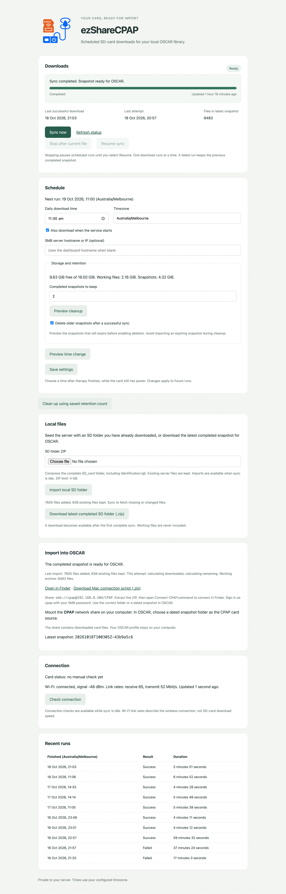

# ezShareCPAP Server

A Docker-hosted ez Share SD-card downloader for CPAP data, with a password-protected web interface and scheduled sync. It runs on a Linux server, including a Proxmox guest with access to the card's Wi-Fi network.

The web interface shows sync progress, the current action, recent results and an estimated download time. You can start, stop and resume a sync, change its schedule, upload an existing SD-folder ZIP to seed the archive, or download the latest completed snapshot. The dashboard also shows storage use, optional snapshot retention, the next scheduled run and connection diagnostics. Interrupted runs can recover after an app restart. A read-only Samba share makes completed snapshots available for local OSCAR imports.

## Dashboard

## Setup

For installation without a local build, use the [public Docker images](docs/container-images.md) and `compose.release.yaml`.

Follow the [Docker deployment guide](docs/docker-deployment.md) for configuration, passwords, networking and startup. The [Proxmox plan](docs/docker-proxmox-plan.md) describes the guest and Wi-Fi setup.

Docker runs inside the Linux guest. The guest needs access to both your home network and the ez Share card. Keep the web interface and file share on your trusted network.

## SD files and OSCAR

A sync keeps a working archive, checks the card for changes, then publishes a completed snapshot. OSCAR can import that snapshot through the network share or from an extracted ZIP download.

To seed the working archive, upload a ZIP of the full SD folder, including Identification.tgt. Import preserves existing server files and rejects a different device identity. Run a sync afterward to download missing or changed files and publish the result.

## Project history

This is a separate repository for the server version, based on [ezShareCPAP](https://github.com/adrianRfeeger/ezShareCPAP). It preserves the source history and existing licence. The inherited desktop application documentation is in [README-desktop.md](README-desktop.md).
